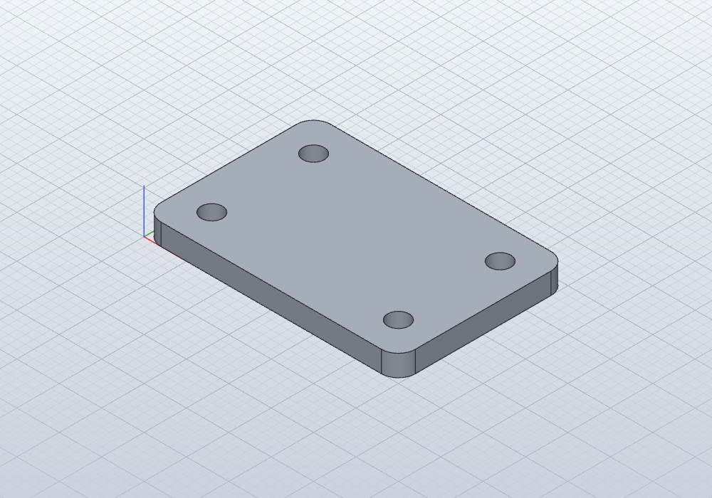

# 01 – Mounting plate

## Brief

- 60 × 40 mm plate, 5 mm thick
- 4 × Ø5 mm holes, centers 8 mm from the two nearest edges
- Corners rounded, R4
- Built from a fully constrained sketch, driven by named parameters:
  `length`, `width`, `thick`, `hole_d`, `inset`

## Attempts

| File | Method | Result |
|------|--------|--------|
| `01-plate.sc` | Box + Hole + Fillet tools | Geometry correct (volume 11538.67 mm³ matches the hand calculation). No sketch, no named parameters. 7/10 |
| `01b-plate.sc` | Sketch-based, parametric | todo |
